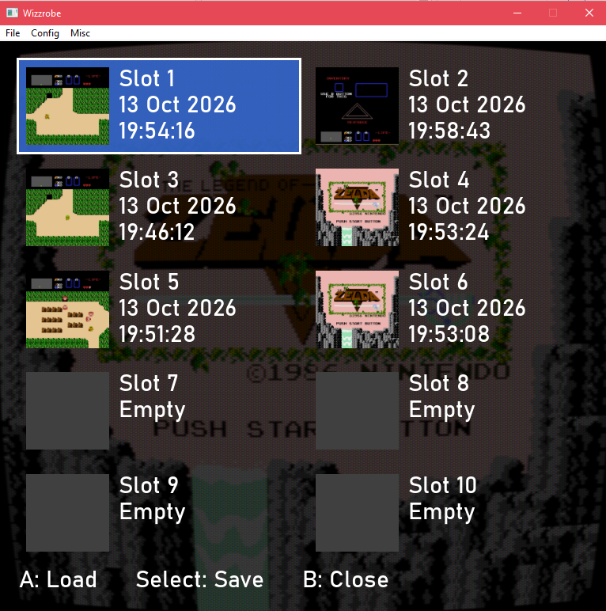
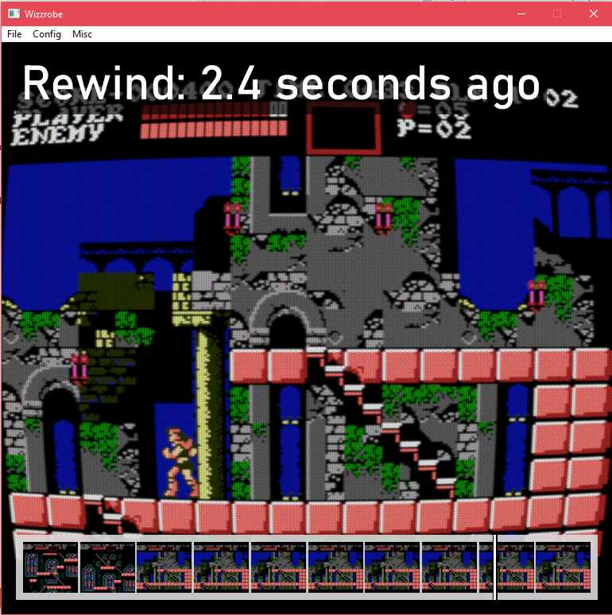
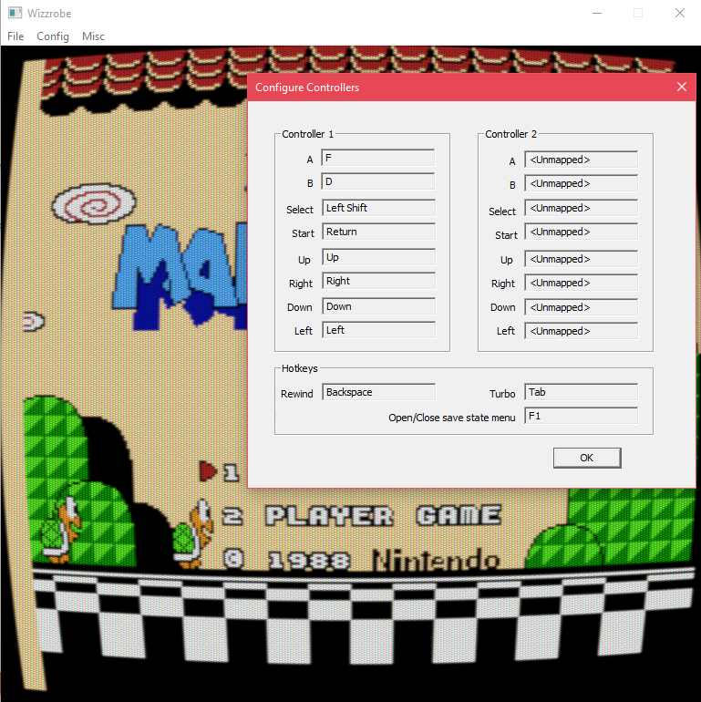
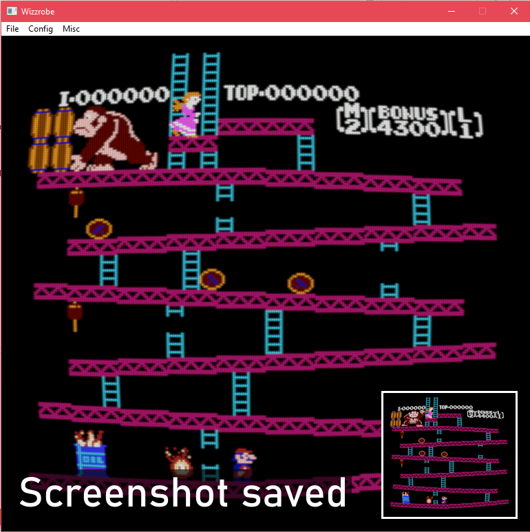

# Wizzrobe

This is an emulator of the Nintendo Entertainment system. Current features are:

- Cycle accurate emulation of the 6502 processor
- PPU
- APU
- Mappers 0 through 5
- Controller with keyboad/gamepad binding
- Savestate functionality with visual interface
- Battery save functionality
- Fast forward, and rewind functionality with visual interface
- CRT filter (courtesy of Timothy Lottes)

# Purpose

The purpose of this, originally, was to better gain an understanding of the 6502 microprocessor, and for how Nintendo games worked. Once the emulation layer reached a good spot, I decided to expand it by adding certain features that I personally value. I knew I wanted basic quality of life features like save states and rewind. However, I specifically wanted these features to feel similar to how they feel on the Switch's official NSO emulators. Beyond that, it was important to me to have a CRT filter that could be configured to my liking. In these ways, the project's target morphed specifically into: create the emulator that _I_ would use to play a NES game.

# Screenshots

